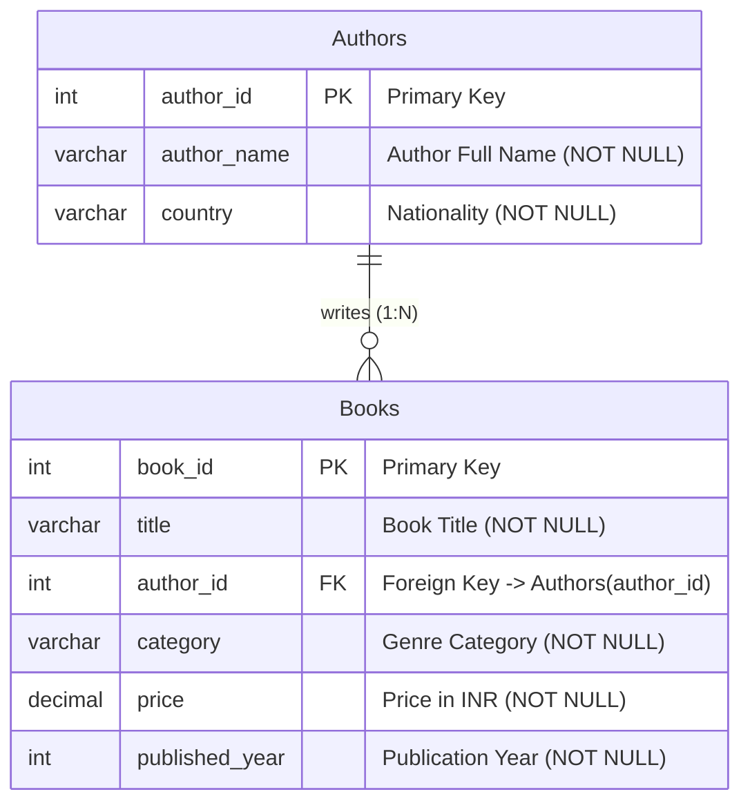
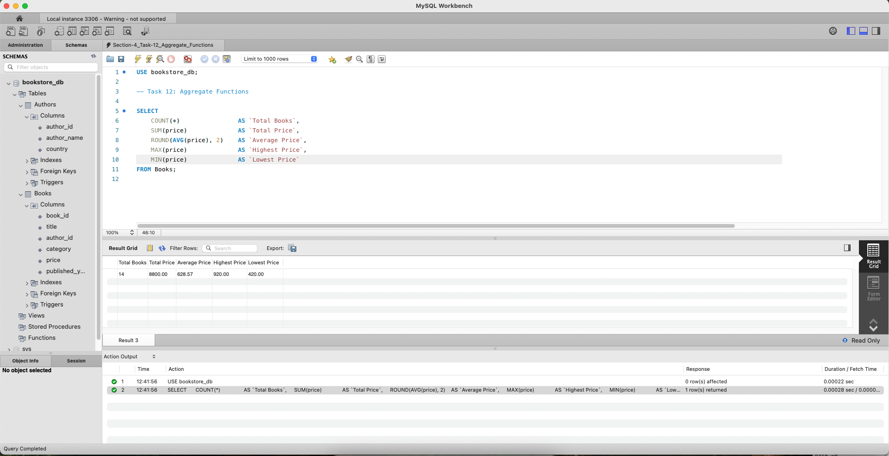
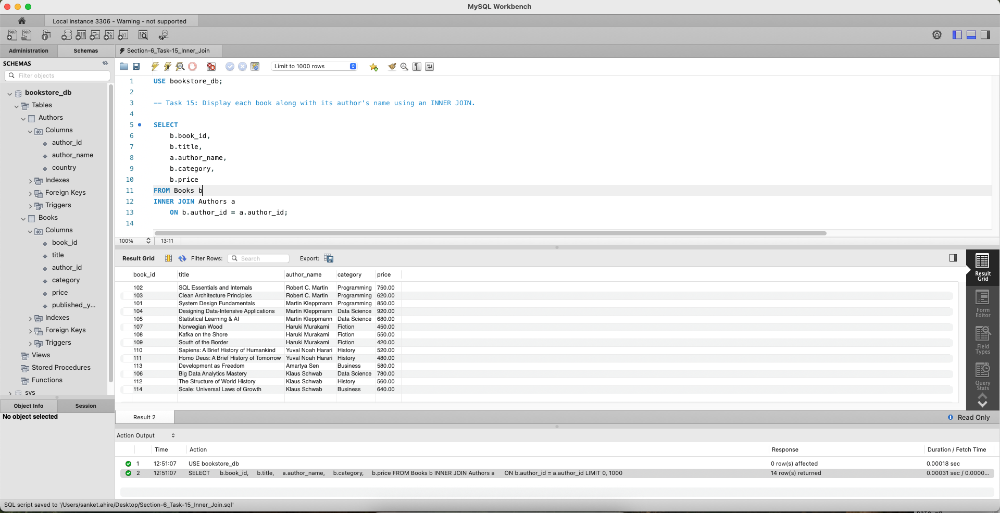

# Online Bookstore Management System (SQL Basic Assignment)

## Overview
This repository contains the database implementation and SQL query solutions for the **SQL (Basic) Assignment**. The project models an online bookstore management system, covering relational schema design, data retrieval, multi-table joins, aggregate analytics, DML lifecycle management, and table constraints.

---

## Project Structure
```text
sql-basic-bookstore-assignment-sanketahire/
├── .gitignore                          # Git ignore rules for OS, IDE, and DB tools
├── README.md                           # Master documentation, schema, and query catalog
├── bookstore_management.sql            # Master SQL script (DDL, seed data, Tasks 1-21)
├── docs/                               # Assignment briefs and reference materials
│   ├── Training.Assignment.SQL (Basic).pdf
│   └── Training.Material.SQL (Basic).pdf
└── screenshots/                        # Milestone execution proofs
    ├── task_12_aggregate_functions.png # (To be captured in Section 4)
    ├── task_15_inner_join.png          # (To be captured in Section 6)
    └── task_21_create_table_publishers.png # (To be captured in Section 8)
```

---

## Database Schema & Architecture

### Entity-Relationship (ER) Diagram


### Data Dictionary

#### 1. `Authors` Table
| Column Name | Data Type | Constraints | Description |
| :--- | :--- | :--- | :--- |
| `author_id` | `INT` | `PRIMARY KEY` | Unique identifier for each author |
| `author_name` | `VARCHAR(100)` | `NOT NULL` | Full name of the author |
| `country` | `VARCHAR(50)` | `NOT NULL` | Country of origin / nationality |

#### 2. `Books` Table
| Column Name | Data Type | Constraints | Description |
| :--- | :--- | :--- | :--- |
| `book_id` | `INT` | `PRIMARY KEY` | Unique identifier for each publication |
| `title` | `VARCHAR(100)` | `NOT NULL` | Title of the book |
| `author_id` | `INT` | `FOREIGN KEY` | References `Authors(author_id)` |
| `category` | `VARCHAR(50)` | `NOT NULL` | Genre / subject classification |
| `price` | `DECIMAL(10,2)` | `NOT NULL` | Price in INR (exact decimal precision) |
| `published_year` | `INT` | `NOT NULL` | Year the book was published |

---

## Steps to Execute the SQL Script

### Option A: Using MySQL Workbench (GUI)
1. Open **MySQL Workbench** and connect to your local MySQL server.
2. Go to **File** $\rightarrow$ **Open SQL Script...** and select [`bookstore_management.sql`](file:///Users/sanket.ahire/Downloads/sql-basic-bookstore-assignment-sanketahire/bookstore_management.sql).
3. Click the **Execute (⚡)** button to run the entire script.
4. Review the generated result grids in the Output tabs.

### Option B: Using MySQL Terminal / Command Line (CLI)
1. Open your terminal and navigate to the project directory:
   ```bash
   cd /path/to/sql-basic-bookstore-assignment-sanketahire
   ```
2. Execute the master script directly into MySQL:
   ```bash
   mysql -u root -p < bookstore_management.sql
   ```
3. Alternatively, launch the MySQL interactive shell and run:
   ```sql
   SOURCE bookstore_management.sql;
   ```

---

## Query Catalog & Execution Results

### Section 1: Basic Queries

#### Task 1: Display all books
* **Description:** Retrieves all columns and all records from the `Books` catalog.
* **SQL Query:**
  ```sql
  SELECT * FROM Books;
  ```
* **Execution Output:**
  | book_id | title | author_id | category | price | published_year |
  | :---: | :--- | :---: | :--- | :---: | :---: |
  | 101 | System Design Fundamentals | 2 | Programming | 850.00 | 2021 |
  | 102 | SQL Essentials and Internals | 1 | Programming | 750.00 | 2022 |
  | 103 | Clean Architecture Principles | 1 | Programming | 620.00 | 2019 |
  | 104 | Designing Data-Intensive Applications | 2 | Data Science | 920.00 | 2017 |
  | 105 | Statistical Learning & AI | 2 | Data Science | 680.00 | 2023 |
  | 106 | Big Data Analytics Mastery | 6 | Data Science | 780.00 | 2022 |
  | 107 | Norwegian Wood | 3 | Fiction | 450.00 | 2018 |
  | 108 | Kafka on the Shore | 3 | Fiction | 550.00 | 2020 |
  | 109 | South of the Border | 3 | Fiction | 420.00 | 2021 |
  | 110 | Sapiens: A Brief History of Humankind | 4 | History | 520.00 | 2018 |
  | 111 | Homo Deus: A Brief History of Tomorrow | 4 | History | 480.00 | 2019 |
  | 112 | The Structure of World History | 6 | History | 560.00 | 2024 |
  | 113 | Development as Freedom | 5 | Business | 580.00 | 2019 |
  | 114 | Scale: Universal Laws of Growth | 6 | Business | 640.00 | 2021 |
  *(14 rows returned)*

#### Task 2: Display only the book title and price
* **Description:** Vertical projection targeting specific business attributes (`title`, `price`).
* **SQL Query:**
  ```sql
  SELECT title, price 
  FROM Books;
  ```
* **Execution Output:**
  | title | price |
  | :--- | :---: |
  | System Design Fundamentals | 850.00 |
  | SQL Essentials and Internals | 750.00 |
  | Clean Architecture Principles | 620.00 |
  | Designing Data-Intensive Applications | 920.00 |
  | Statistical Learning & AI | 680.00 |
  | Big Data Analytics Mastery | 780.00 |
  | Norwegian Wood | 450.00 |
  | Kafka on the Shore | 550.00 |
  | South of the Border | 420.00 |
  | Sapiens: A Brief History of Humankind | 520.00 |
  | Homo Deus: A Brief History of Tomorrow | 480.00 |
  | The Structure of World History | 560.00 |
  | Development as Freedom | 580.00 |
  | Scale: Universal Laws of Growth | 640.00 |
  *(14 rows returned)*

#### Task 3: Display the book title as Book Name and price as Book Price using column aliases
* **Description:** Applies user-friendly column headers (`Book Name`, `Book Price`) with quoted aliases.
* **SQL Query:**
  ```sql
  SELECT title AS `Book Name`, price AS `Book Price` 
  FROM Books;
  ```
* **Execution Output:**
  | Book Name | Book Price |
  | :--- | :---: |
  | System Design Fundamentals | 850.00 |
  | SQL Essentials and Internals | 750.00 |
  | Clean Architecture Principles | 620.00 |
  | Designing Data-Intensive Applications | 920.00 |
  | Statistical Learning & AI | 680.00 |
  | Big Data Analytics Mastery | 780.00 |
  | Norwegian Wood | 450.00 |
  | Kafka on the Shore | 550.00 |
  | South of the Border | 420.00 |
  | Sapiens: A Brief History of Humankind | 520.00 |
  | Homo Deus: A Brief History of Tomorrow | 480.00 |
  | The Structure of World History | 560.00 |
  | Development as Freedom | 580.00 |
  | Scale: Universal Laws of Growth | 640.00 |
  *(14 rows returned)*

#### Task 4: Display all unique book categories
* **Description:** Deduplicates category classifications using `DISTINCT`.
* **SQL Query:**
  ```sql
  SELECT DISTINCT category 
  FROM Books;
  ```
* **Execution Output:**
  | category |
  | :--- |
  | Programming |
  | Data Science |
  | Fiction |
  | History |
  | Business |
  *(5 rows returned)*


---

### Section 2: Filtering Data

#### Task 5: Display books priced above ₹700
* **Description:** Filters the dataset for books priced strictly greater than ₹700 (`price > 700`).
* **SQL Query:**
  ```sql
  SELECT * 
  FROM Books 
  WHERE price > 700;
  ```
* **Execution Output:**
  | book_id | title | author_id | category | price | published_year |
  | :---: | :--- | :---: | :--- | :---: | :---: |
  | 101 | System Design Fundamentals | 2 | Programming | 850.00 | 2021 |
  | 102 | SQL Essentials and Internals | 1 | Programming | 750.00 | 2022 |
  | 104 | Designing Data-Intensive Applications | 2 | Data Science | 920.00 | 2017 |
  | 106 | Big Data Analytics Mastery | 6 | Data Science | 780.00 | 2022 |
  *(4 rows returned)*

#### Task 6: Display books priced between ₹500 and ₹800
* **Description:** Uses the inclusive `BETWEEN ... AND ...` operator to retrieve publications in the ₹500 to ₹800 range.
* **SQL Query:**
  ```sql
  SELECT * 
  FROM Books 
  WHERE price BETWEEN 500 AND 800;
  ```
* **Execution Output:**
  | book_id | title | author_id | category | price | published_year |
  | :---: | :--- | :---: | :--- | :---: | :---: |
  | 102 | SQL Essentials and Internals | 1 | Programming | 750.00 | 2022 |
  | 103 | Clean Architecture Principles | 1 | Programming | 620.00 | 2019 |
  | 105 | Statistical Learning & AI | 2 | Data Science | 680.00 | 2023 |
  | 106 | Big Data Analytics Mastery | 6 | Data Science | 780.00 | 2022 |
  | 108 | Kafka on the Shore | 3 | Fiction | 550.00 | 2020 |
  | 110 | Sapiens: A Brief History of Humankind | 4 | History | 520.00 | 2018 |
  | 112 | The Structure of World History | 6 | History | 560.00 | 2024 |
  | 113 | Development as Freedom | 5 | Business | 580.00 | 2019 |
  | 114 | Scale: Universal Laws of Growth | 6 | Business | 640.00 | 2021 |
  *(9 rows returned)*

#### Task 7: Display books that belong to the Programming category
* **Description:** Performs an exact equality filter on the `category` attribute (`category = 'Programming'`).
* **SQL Query:**
  ```sql
  SELECT * 
  FROM Books 
  WHERE category = 'Programming';
  ```
* **Execution Output:**
  | book_id | title | author_id | category | price | published_year |
  | :---: | :--- | :---: | :--- | :---: | :---: |
  | 101 | System Design Fundamentals | 2 | Programming | 850.00 | 2021 |
  | 102 | SQL Essentials and Internals | 1 | Programming | 750.00 | 2022 |
  | 103 | Clean Architecture Principles | 1 | Programming | 620.00 | 2019 |
  *(3 rows returned)*

#### Task 8: Display books whose titles start with the letter S
* **Description:** Utilizes pattern matching with the `LIKE 'S%'` predicate to identify publications where the first character is 'S'.
* **SQL Query:**
  ```sql
  SELECT * 
  FROM Books 
  WHERE title LIKE 'S%';
  ```
* **Execution Output:**
  | book_id | title | author_id | category | price | published_year |
  | :---: | :--- | :---: | :--- | :---: | :---: |
  | 101 | System Design Fundamentals | 2 | Programming | 850.00 | 2021 |
  | 102 | SQL Essentials and Internals | 1 | Programming | 750.00 | 2022 |
  | 105 | Statistical Learning & AI | 2 | Data Science | 680.00 | 2023 |
  | 109 | South of the Border | 3 | Fiction | 420.00 | 2021 |
  | 110 | Sapiens: A Brief History of Humankind | 4 | History | 520.00 | 2018 |
  | 114 | Scale: Universal Laws of Growth | 6 | Business | 640.00 | 2021 |
  *(6 rows returned)*

#### Task 9: Display books published after 2020
* **Description:** Performs temporal filtering to retrieve recent publications published strictly after 2020 (`published_year > 2020`).
* **SQL Query:**
  ```sql
  SELECT * 
  FROM Books 
  WHERE published_year > 2020;
  ```
* **Execution Output:**
  | book_id | title | author_id | category | price | published_year |
  | :---: | :--- | :---: | :--- | :---: | :---: |
  | 101 | System Design Fundamentals | 2 | Programming | 850.00 | 2021 |
  | 102 | SQL Essentials and Internals | 1 | Programming | 750.00 | 2022 |
  | 105 | Statistical Learning & AI | 2 | Data Science | 680.00 | 2023 |
  | 106 | Big Data Analytics Mastery | 6 | Data Science | 780.00 | 2022 |
  | 109 | South of the Border | 3 | Fiction | 420.00 | 2021 |
  | 112 | The Structure of World History | 6 | History | 560.00 | 2024 |
  | 114 | Scale: Universal Laws of Growth | 6 | Business | 640.00 | 2021 |
  *(7 rows returned)*


---

### Section 3: Sorting and Limiting Results

#### Task 10: Display books sorted by price in descending order
* **Description:** Orders the entire book catalog from highest to lowest monetary value (`ORDER BY price DESC`).
* **SQL Query:**
  ```sql
  SELECT * 
  FROM Books 
  ORDER BY price DESC;
  ```
* **Execution Output:**
  | book_id | title | author_id | category | price | published_year |
  | :---: | :--- | :---: | :--- | :---: | :---: |
  | 104 | Designing Data-Intensive Applications | 2 | Data Science | 920.00 | 2017 |
  | 101 | System Design Fundamentals | 2 | Programming | 850.00 | 2021 |
  | 106 | Big Data Analytics Mastery | 6 | Data Science | 780.00 | 2022 |
  | 102 | SQL Essentials and Internals | 1 | Programming | 750.00 | 2022 |
  | 105 | Statistical Learning & AI | 2 | Data Science | 680.00 | 2023 |
  | 114 | Scale: Universal Laws of Growth | 6 | Business | 640.00 | 2021 |
  | 103 | Clean Architecture Principles | 1 | Programming | 620.00 | 2019 |
  | 113 | Development as Freedom | 5 | Business | 580.00 | 2019 |
  | 112 | The Structure of World History | 6 | History | 560.00 | 2024 |
  | 108 | Kafka on the Shore | 3 | Fiction | 550.00 | 2020 |
  | 110 | Sapiens: A Brief History of Humankind | 4 | History | 520.00 | 2018 |
  | 111 | Homo Deus: A Brief History of Tomorrow | 4 | History | 480.00 | 2019 |
  | 107 | Norwegian Wood | 3 | Fiction | 450.00 | 2018 |
  | 109 | South of the Border | 3 | Fiction | 420.00 | 2021 |
  *(14 rows returned)*

#### Task 11: Display the top 3 most expensive books
* **Description:** Combines descending price ordering with row-limiting cardinality (`LIMIT 3`) to yield the top three premium catalog entries.
* **SQL Query:**
  ```sql
  SELECT * 
  FROM Books 
  ORDER BY price DESC 
  LIMIT 3;
  ```
* **Execution Output:**
  | book_id | title | author_id | category | price | published_year |
  | :---: | :--- | :---: | :--- | :---: | :---: |
  | 104 | Designing Data-Intensive Applications | 2 | Data Science | 920.00 | 2017 |
  | 101 | System Design Fundamentals | 2 | Programming | 850.00 | 2021 |
  | 106 | Big Data Analytics Mastery | 6 | Data Science | 780.00 | 2022 |
  *(3 rows returned)*


---

### Section 4: Aggregate Functions

#### Task 12: Multi-metric statistical calculations
* **Description:** Calculates the total volume of catalog items (`COUNT(*)`), cumulative valuation (`SUM(price)`), mean price (`ROUND(AVG(price), 2)`), and price extremes (`MAX(price)`, `MIN(price)`).
* **SQL Query:**
  ```sql
  SELECT 
      COUNT(*)                AS `Total Books`,
      SUM(price)              AS `Total Price`,
      ROUND(AVG(price), 2)    AS `Average Price`,
      MAX(price)              AS `Highest Price`,
      MIN(price)              AS `Lowest Price`
  FROM Books;
  ```
* **Execution Output:**
  | Total Books | Total Price | Average Price | Highest Price | Lowest Price |
  | :---: | :---: | :---: | :---: | :---: |
  | 14 | 8800.00 | 628.57 | 920.00 | 420.00 |
  *(1 row returned)*

* **Execution Screenshot (Mandatory Deliverable):**
  


---

### Section 5: GROUP BY and HAVING

#### Task 13: Display the average book price for each category
* **Description:** Groups records by genre classification (`GROUP BY category`) and computes the discrete arithmetic mean price per bucket.
* **SQL Query:**
  ```sql
  SELECT 
      category, 
      ROUND(AVG(price), 2) AS `Average Price`
  FROM Books
  GROUP BY category;
  ```
* **Execution Output:**
  | category | Average Price |
  | :--- | :---: |
  | Programming | 740.00 |
  | Data Science | 793.33 |
  | Fiction | 473.33 |
  | History | 520.00 |
  | Business | 610.00 |
  *(5 rows returned)*

#### Task 14: Display categories whose average book price exceeds ₹650
* **Description:** Employs post-aggregation filtering (`HAVING AVG(price) > 650`) to restrict output strictly to categories with premium average valuation.
* **SQL Query:**
  ```sql
  SELECT 
      category, 
      ROUND(AVG(price), 2) AS `Average Price`
  FROM Books
  GROUP BY category
  HAVING AVG(price) > 650;
  ```
* **Execution Output:**
  | category | Average Price |
  | :--- | :---: |
  | Programming | 740.00 |
  | Data Science | 793.33 |
  *(2 rows returned)*

> **Core Concept Highlight (WHERE vs. HAVING):**  
> `WHERE` filters individual rows prior to grouping, whereas `HAVING` filters group partitions after aggregate computations have occurred. Aggregate expressions such as `AVG(price)` cannot appear inside a `WHERE` clause because grouping has not yet been executed at that stage of query evaluation.


---

### Section 6: Joins

#### Task 15: Display each book along with its author's name using an INNER JOIN
* **Description:** Combines records from `Books` and `Authors` based on relational key matching (`ON b.author_id = a.author_id`). Unmatched rows from either table are omitted.
* **SQL Query:**
  ```sql
  SELECT 
      b.book_id,
      b.title,
      a.author_name,
      b.category,
      b.price
  FROM Books b
  INNER JOIN Authors a 
      ON b.author_id = a.author_id;
  ```
* **Execution Output:**
  | book_id | title | author_name | category | price |
  | :---: | :--- | :--- | :--- | :---: |
  | 102 | SQL Essentials and Internals | Robert C. Martin | Programming | 750.00 |
  | 103 | Clean Architecture Principles | Robert C. Martin | Programming | 620.00 |
  | 101 | System Design Fundamentals | Martin Kleppmann | Programming | 850.00 |
  | 104 | Designing Data-Intensive Applications | Martin Kleppmann | Data Science | 920.00 |
  | 105 | Statistical Learning & AI | Martin Kleppmann | Data Science | 680.00 |
  | 107 | Norwegian Wood | Haruki Murakami | Fiction | 450.00 |
  | 108 | Kafka on the Shore | Haruki Murakami | Fiction | 550.00 |
  | 109 | South of the Border | Haruki Murakami | Fiction | 420.00 |
  | 110 | Sapiens: A Brief History of Humankind | Yuval Noah Harari | History | 520.00 |
  | 111 | Homo Deus: A Brief History of Tomorrow | Yuval Noah Harari | History | 480.00 |
  | 113 | Development as Freedom | Amartya Sen | Business | 580.00 |
  | 106 | Big Data Analytics Mastery | Klaus Schwab | Data Science | 780.00 |
  | 112 | The Structure of World History | Klaus Schwab | History | 560.00 |
  | 114 | Scale: Universal Laws of Growth | Klaus Schwab | Business | 640.00 |
  *(14 rows returned)*

* **Execution Screenshot (Mandatory Deliverable):**
  

#### Task 16: Display all authors along with the books they have written using a LEFT JOIN
* **Description:** Preserves all records from the left relation (`Authors`). For authors without published books (such as Author 7: Margaret Atwood), corresponding book fields evaluate to `NULL`.
* **SQL Query:**
  ```sql
  SELECT 
      a.author_id,
      a.author_name,
      a.country,
      b.title,
      b.price
  FROM Authors a
  LEFT JOIN Books b 
      ON a.author_id = b.author_id;
  ```
* **Execution Output:**
  | author_id | author_name | country | title | price |
  | :---: | :--- | :--- | :--- | :---: |
  | 1 | Robert C. Martin | USA | SQL Essentials and Internals | 750.00 |
  | 1 | Robert C. Martin | USA | Clean Architecture Principles | 620.00 |
  | 2 | Martin Kleppmann | UK | System Design Fundamentals | 850.00 |
  | 2 | Martin Kleppmann | UK | Designing Data-Intensive Applications | 920.00 |
  | 2 | Martin Kleppmann | UK | Statistical Learning & AI | 680.00 |
  | 3 | Haruki Murakami | Japan | Norwegian Wood | 450.00 |
  | 3 | Haruki Murakami | Japan | Kafka on the Shore | 550.00 |
  | 3 | Haruki Murakami | Japan | South of the Border | 420.00 |
  | 4 | Yuval Noah Harari | Israel | Sapiens: A Brief History of Humankind | 520.00 |
  | 4 | Yuval Noah Harari | Israel | Homo Deus: A Brief History of Tomorrow | 480.00 |
  | 5 | Amartya Sen | India | Development as Freedom | 580.00 |
  | 6 | Klaus Schwab | Germany | Big Data Analytics Mastery | 780.00 |
  | 6 | Klaus Schwab | Germany | The Structure of World History | 560.00 |
  | 6 | Klaus Schwab | Germany | Scale: Universal Laws of Growth | 640.00 |
  | 7 | Margaret Atwood | Canada | *NULL* | *NULL* |
  *(15 rows returned)*

#### Task 17: Display all books along with their author details using a RIGHT JOIN
* **Description:** Guarantees preservation of all records from the right relation (`Books`), merging author details where relationships exist.
* **SQL Query:**
  ```sql
  SELECT 
      b.book_id,
      b.title,
      a.author_name,
      a.country,
      b.price
  FROM Authors a
  RIGHT JOIN Books b 
      ON a.author_id = b.author_id;
  ```
* **Execution Output:**
  | book_id | title | author_name | country | price |
  | :---: | :--- | :--- | :--- | :---: |
  | 101 | System Design Fundamentals | Martin Kleppmann | UK | 850.00 |
  | 102 | SQL Essentials and Internals | Robert C. Martin | USA | 750.00 |
  | 103 | Clean Architecture Principles | Robert C. Martin | USA | 620.00 |
  | 104 | Designing Data-Intensive Applications | Martin Kleppmann | UK | 920.00 |
  | 105 | Statistical Learning & AI | Martin Kleppmann | UK | 680.00 |
  | 106 | Big Data Analytics Mastery | Klaus Schwab | Germany | 780.00 |
  | 107 | Norwegian Wood | Haruki Murakami | Japan | 450.00 |
  | 108 | Kafka on the Shore | Haruki Murakami | Japan | 550.00 |
  | 109 | South of the Border | Haruki Murakami | Japan | 420.00 |
  | 110 | Sapiens: A Brief History of Humankind | Yuval Noah Harari | Israel | 520.00 |
  | 111 | Homo Deus: A Brief History of Tomorrow | Yuval Noah Harari | Israel | 480.00 |
  | 112 | The Structure of World History | Klaus Schwab | Germany | 560.00 |
  | 113 | Development as Freedom | Amartya Sen | India | 580.00 |
  | 114 | Scale: Universal Laws of Growth | Klaus Schwab | Germany | 640.00 |
  *(14 rows returned)*
